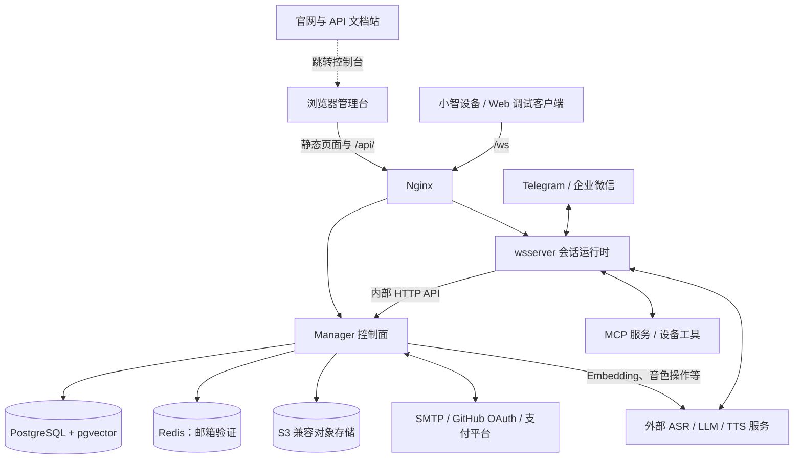
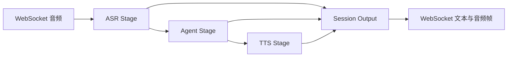
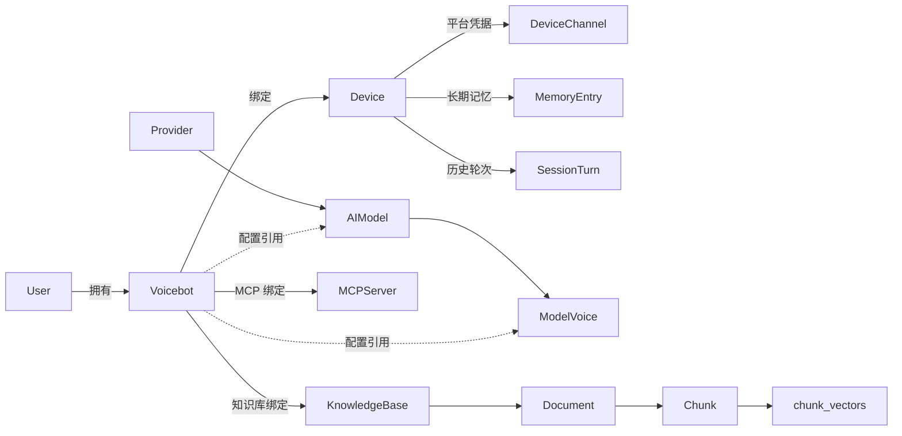

# Orion-X 项目架构与新人入职指南

本文帮助新成员建立项目全貌，定位服务和模块，并完成第一次本地联调。内容按 **2026-11-05 当前仓库实现**整理，描述源码和部署模板，不代表线上环境的运行审计。

阅读优先级：当前入口、路由和调用代码 > 本文 > 历史设计文档。`docs/` 中部分材料是方案或演进记录，不能仅凭文件名认定功能已上线。代码变化后，请同步更新受影响的章节。

## 阅读导航

- [1. 项目定位与核心概念](#1-项目定位与核心概念)
- [2. 服务全景与部署边界](#2-服务全景与部署边界)
- [3. Manager 控制面](#3-manager-控制面)
- [4. wsserver 会话运行时](#4-wsserver-会话运行时)
- [5. 管理台与官网文档站](#5-管理台与官网文档站)
- [6. 本地 CLI 与辅助工具](#6-本地-cli-与辅助工具)
- [7. 共享模块地图](#7-共享模块地图)
- [8. 数据模型与状态归属](#8-数据模型与状态归属)
- [9. 核心业务链路](#9-核心业务链路)
- [10. 配置与本地开发](#10-配置与本地开发)
- [11. 部署与排障](#11-部署与排障)
- [12. 开发规范与变更入口](#12-开发规范与变更入口)
- [13. 当前边界](#13-当前边界)
- [14. 新人学习路径与延伸阅读](#14-新人学习路径与延伸阅读)

## 1. 项目定位与核心概念

Orion-X 将语音识别、语言模型、语音合成、记忆、知识检索和工具组合成可配置的智能体，通过设备和通信平台与用户交互。

主架构是 **Go 单仓库、两个主要后端进程、两个独立前端项目**：Manager 管配置和业务数据，wsserver 管实时执行，Web Manager 提供管理界面，docs-site 提供官网和 API 文档。后端内部按模块组织；计费、知识库、记忆目前不是独立部署的微服务。

| 概念 | 含义与代码对应 |
| --- | --- |
| 智能体 / Voicebot | 配置实体，包含模型选择、角色提示词、语音参数等。UI 称“智能体”，数据库和 API 仍使用 `Voicebot`、`/voicebots` |
| Agent | `internal/agent` 中执行 LLM 与工具循环的运行时对象，与数据库中的智能体配置不是同一个对象 |
| Device | 智能体下的接入身份，不限于物理硬件。通过 `device_id` 查找配置，记忆和持久化轮次也按设备关联 |
| Channel | 平台适配器，目前启动小智 WebSocket、Telegram、企业微信三种通道 |
| Session / Turn | Session 是运行中的会话；Turn 是一轮用户输入和智能体响应 |
| Provider / AIModel / Voice | 供应商及凭据、具体模型、音色；Manager 将这些引用解析成运行时配置 |
| ASR / LLM / TTS | 语音转文本 / 语言模型推理 / 文本转语音 |
| VAD | 语音活动检测，用于判断说话开始、结束和音频分段 |
| MCP | 工具接入协议；连接外部工具服务，小智还可提供设备端工具 |
| Pipeline / DAG | 流式阶段的执行图；DAG 是可分叉、汇合的有向无环图 |

## 2. 服务全景与部署边界



### 2.1 运行单元清单

| 单元 | 入口 / 配置 | 默认端口 | 部署职责 |
| --- | --- | --- | --- |
| Manager | [cmd/manager/main.go](../cmd/manager/main.go)、`data/manager.yaml` | `9090` | HTTP API、配置组装、业务持久化、后台结算等 |
| wsserver | [cmd/wsserver/main.go](../cmd/wsserver/main.go)、`data/wsserver.yaml` | `8080`；健康检查 `8081` | 多通道接入、会话、语音流水线、Agent 执行 |
| Web Manager | [web/manager/package.json](../web/manager/package.json) | 开发 `5173` | React SPA，生产静态文件由 Nginx 提供 |
| 官网 / API 文档站 | [docs-site/package.json](../docs-site/package.json) | 开发 `5174` | VitePress 静态站，独立构建发布 |
| Nginx | [deploy/nginx.conf](../deploy/nginx.conf) | 容器 `80` | 托管管理台、代理 API 和 WebSocket |
| PostgreSQL | [deploy/docker-compose.yml](../deploy/docker-compose.yml) | 容器 `5432` | 关系数据与 pgvector 向量；生产模板不映射数据库公网端口 |
| Redis | Manager 的 `redis` 配置 | 按部署配置 | 邮箱验证令牌及重发冷却；未包含在现有 Compose 中 |
| S3 兼容存储 | Manager 的 `storage` 配置 | 按服务商配置 | 上传文件与预签名访问；未包含在现有 Compose 中 |
| voicebot CLI | [cmd/voicebot/main.go](../cmd/voicebot/main.go) | 无 | 本机麦克风、扬声器语音联调 |
| tools CLI | [cmd/tools/main.go](../cmd/tools/main.go) | 无 | 生成兼容 Manager 的 bcrypt 密码哈希 |

SMTP、GitHub OAuth、支付平台、模型平台和 MCP 是外部集成，不是本仓库中独立启动的服务。

### 2.2 服务间边界

- 浏览器通过 `/api/*` 管理配置；实时对话走 wsserver 的 `/ws`。
- wsserver 通过 Manager 的内部 HTTP API 获取设备配置、访问记忆和知识库、校验凭证、上报计费事实。
- 业务数据库访问集中在 Manager；wsserver 通道主链路不直接连接 PostgreSQL。
- ASR、LLM、TTS 推理由运行时调用模型服务；Manager 也因知识向量化、音色复刻调用模型服务。
- `channels.Manager` 是 wsserver 内部的通道生命周期管理器，不能与独立 Manager HTTP 服务混淆。

### 2.3 仓库目录速查

| 目录 / 文件 | 新人通常在这里找什么 |
| --- | --- |
| `cmd/` | 后端与 CLI 的进程入口、Manager 路由和 handler |
| `internal/` | 业务模块、平台适配和持久化实现 |
| `pkg/pipeline/` | 可复用的流式执行基础设施 |
| `web/manager/` | React 管理台 |
| `docs-site/` | 官网、API 文档站和 VitePress 主题 |
| `docs/` | 本指南、专题设计、协议和生成的 OpenAPI 文件 |
| `deploy/`、`Dockerfile` | 部署配置、镜像构建、反向代理和运维脚本 |
| `data/`、`models/` | 本地运行配置 / 数据及语音模型资源；真实凭据不应提交 |
| `test/`、`testdata/` | 手工测试页面和音频样本；Go 单元测试分布在对应包旁 |
| `.github/workflows/` | Go CI、镜像发布、文档站发布及仓库自动化 |
| `Makefile`、`go.mod` | 常用开发命令、Go 版本及依赖 |
| `bin/` | 本地构建产物，不是业务源码 |

## 3. Manager 控制面

### 3.1 启动与分层

阅读入口：[main.go](../cmd/manager/main.go) → [server.go](../cmd/manager/server.go) → [handler/](../cmd/manager/handler) → 对应领域模块 / [store/](../internal/store)。

启动时加载 YAML、初始化日志、打开数据库并执行 GORM `AutoMigrate` 和兼容迁移，然后同步系统 Provider、模型、音色、智能体模板与计费项目录。接着装配知识库、资源、鉴权、支付和计费等能力，启动后台 worker，最后监听 HTTP。

当前不是所有业务都有独立 service 层：简单 CRUD 由 handler 调用 Store；知识库、资源、计费等较复杂逻辑有自己的服务模块。新增代码应遵循所在模块的实际结构。

### 3.2 业务模块

下表中的 `handler/` 均指 `cmd/manager/handler/`。

| 模块 | 责任 | 主要实现 |
| --- | --- | --- |
| 账号与登录 | 注册、登录、JWT、密码修改、邮箱绑定和验证 | `handler/auth.go`、`email_verify*.go`、`middleware/auth.go`、`internal/mailer` |
| OAuth | 第三方登录、绑定和解绑；当前实现 GitHub | `handler/oauth.go`、`internal/oauth` |
| API Key | 创建和撤销、scope、按 Key 限流、调用计数、设备连接校验 | `handler/apikey.go`、`middleware/apikey.go`、`internal/apikey` |
| 智能体与设备 | 智能体配置、设备归属、模板广场、可用资源查询 | `handler/voicebot.go`、`device.go`、`agent_template.go`、`available.go` |
| 通道配置 | 平台能力及字段 Schema、设备凭据、企业微信扫码绑定 | `handler/channel.go`、`internal/channels/platform`、`qrbind`、`wecom/qrlogin` |
| 模型与音色 | 供应商、模型、音色 CRUD、预览与复刻、语言能力 | `handler/provider.go`、`model.go`、`voice*.go`、`language.go` |
| MCP 配置 | 市场、用户 MCP 服务、智能体绑定、连接测试和工具试调 | `handler/mcp.go`、`mcp_tooltest.go` |
| 记忆和历史轮次 | 按设备管理记忆、写入轮次、历史全文检索 | `handler/memory.go`、`data_memory.go`、`turn.go` |
| 知识库 | 文档 / URL 导入、异步解析切分、Embedding、向量检索、智能体绑定 | `handler/data_knowledge.go`、`internal/knowledge` |
| 资源文件 | 上传校验、文件元数据、归属校验、预签名访问、删除 | `handler/asset.go`、`internal/assets`、`internal/storage` |
| 计费 | 价格、账户、预冻结、用量事件、结算、流水、报表、调账 | `handler/billing*.go`、`internal/billing/service` |
| 支付 | 充值订单、支付通知、查单、退款、过期订单清理 | `handler/payment.go`、`internal/billing/service/payment.go`、`gateway/epay` |
| 内部配置组装 | 从设备找到智能体，将模型、音色、MCP 等解析为 `AppConfig` | `handler/internal.go` |

### 3.3 HTTP 边界与鉴权

| 路由范围 | 使用方 | 说明 |
| --- | --- | --- |
| `/api/auth/*` | 管理台 | 登录注册等入口；修改账号资料等操作仍要求 JWT |
| `/api/voicebots`、`/api/models`、`/api/data/*` 等 | 管理台和外部集成 | 按路由接受 JWT 或 API Key，并执行 scope / 资源归属检查 |
| `/api/api-keys` | 登录用户 | Key 管理要求 JWT |
| `/api/billing/*` | 用户 / 管理员 | 读接口、钱包操作、管理操作具有不同权限要求 |
| `/internal/device-config`、`/internal/channels/:platform/devices` | wsserver | 下发运行时配置与通道凭据 |
| `/internal/devices/:device_id/*`、`/internal/knowledge/search` | 运行时 | 记忆、历史轮次与知识检索 |
| `/internal/billing/*`、`/internal/apikey/verify` | wsserver | 使用 `internal.token` 进行服务间鉴权 |
| `/pay/epay/notify`、`/pay/epay/return` | 支付平台 / 浏览器 | 支付回调和支付完成跳转，独立于 `/api` 路由 |
| `/healthz`、`/api-docs`、`/swagger/*` | 运维 / 开发者 | 进程健康、API 文档入口 |

**不能把所有 `/internal/*` 都视为已经统一启用 token 校验。** 当前显式给计费和 API Key 校验接口挂载 `InternalAuth`，其余内部接口仍依赖网络边界。仓库 Nginx 对公网 `/internal/` 返回 404。完整路由以 [server.go](../cmd/manager/server.go) 为准，权限映射见 [scope_table.go](../cmd/manager/middleware/scope_table.go)。

### 3.4 后台处理

- 计费结算和预冻结回收：Manager 进程内 goroutine；结算使用数据库锁及 `SKIP LOCKED` 协调多实例消费。
- 支付订单清理：支付启用后启动 sweeper。
- API Key 使用计数：进程内聚合、定时刷库，属于近似统计，不用于财务对账。
- 知识库摄取：Manager 内启动异步 goroutine，文档状态写数据库；没有独立摄取 worker 服务或消息队列。
- 企业微信扫码会话：Manager 内装配 Binder，通过外部扫码端点取得凭据并写入设备通道配置。


## 4. wsserver 会话运行时

### 4.1 组成与生命周期

[cmd/wsserver/main.go](../cmd/wsserver/main.go) 创建公共依赖：设备配置加载器、Session Manager、Task Registry、Provider Pool、工具管理器、记忆服务，以及可配置的计费与 Key 校验客户端。随后注册并启动三类通道，同时在独立端口提供健康检查。

| 层次 | 模块 | 职责 |
| --- | --- | --- |
| 通道框架 | `internal/channels/channel.go`、`manager.go` | 统一 Start / Stop 生命周期和依赖注入 |
| 小智通道 | `internal/channels/xiaozhi` | 握手、设备配置加载、WebSocket 收发、音频输入、输出节奏、打断、设备 MCP 与 IoT |
| Telegram 通道 | `internal/channels/tg` | 每设备 Bot 轮询、消息处理、文本流式更新、语音文件识别 |
| 企业微信通道 | `internal/channels/wecom` | Bot 长连接、鉴权、重连、消息帧、文本流式响应、会话管理 |
| 会话与任务 | `internal/session`、`internal/task` | 活跃会话、历史消息、后台任务和事件投递 |
| 智能体 | `internal/agent` | 上下文构建、LLM 调用、工具执行循环、流式事件与用量 |
| 语音处理 | `internal/audio`、`internal/text` | VAD、ASR、TTS、编解码、采样率转换、文本分段 |
| 流式执行 | `pkg/pipeline` | 阶段执行、DAG 路由、事件分发和取消 |

### 4.2 通道能力有差异

| 通道 | 外部连接方式 | 配置刷新 | 主要执行路径 |
| --- | --- | --- | --- |
| 小智 | 客户端连接 `/ws`，发送 hello 和音频 / 文本 | 建立连接时按 `device_id` 装配配置 | 每连接创建 ASR → Agent → TTS DAG |
| Telegram | 每设备 Bot 长轮询 Telegram | 每 30 秒向 Manager 刷新通道设备列表 | 消息处理时调用 `Agent.Run`；语音文件先识别 |
| 企业微信 | wsserver 主动建立机器人 WebSocket 长连接 | 每 30 秒向 Manager 刷新通道设备列表 | 会话内调用 `Agent.Run`，流式回复文本 |

通道设备列表刷新不等同于对全部活跃会话热更新。现有连接是否重建、配置何时重新加载，应查看各通道实现。企业微信当前声明的是文本和文本流能力，不应理解为完整实时语音通道。

当前小智通道显式接入会话计费、按设备创建的记忆服务和知识检索工具。Telegram / 企业微信的 Agent 使用启动时注入的公共记忆服务，其通道实现尚未接入同样的会话计费和设备级记忆 / 知识工具装配。共享依赖结构不能作为这些能力已经完整接通的证据。

### 4.3 小智连接的处理图



建图代码在 [xiaozhi/channel.go](../internal/channels/xiaozhi/channel.go) 的 `newConnection`。ASR、LLM 文本和 TTS 音频分别汇入 `session_output`，客户端可以逐步收到识别结果、回答文本和音频。VAD / ASR 处理器负责音频分段，输出网关及 AudioPacer 处理协议输出与播放节奏。

连接状态、流水线和运行中的任务在进程内存中；持久化轮次不等于保存了整个实时执行现场。

### 4.4 Agent、工具与任务

[agent/loop.go](../internal/agent/loop.go) 的主循环是：构建上下文 → 调用模型 → 将回复和工具请求加入会话 → 执行工具 → 把工具结果加入会话 → 再次调用模型。无工具调用、达到最大步数或 context 取消时结束。

- 上下文由角色提示词、规则、可用记忆和会话历史构成。
- 工具通过 `internal/tools.Registry` 统一注册和执行，MCP 支持 `stdio`、SSE、Streamable HTTP。
- 小智每连接显式装配设备 MCP、记忆、历史会话检索、知识库检索等能力。其他通道是否提供同样工具，要核对各自装配代码，不能仅根据共享 Agent 推断。
- `internal/task` 用本地后台执行器运行独立 LLM 工具循环，提供 `CreateTask`、`SearchTasks`、`MountTask`、`DismountTask`、`GetTaskProgress` 工具。
- 任务事件通过已挂载会话的 Pipeline 投递；任务注册表是进程内状态，不是持久化任务队列。

## 5. 管理台与官网文档站

### 5.1 Web Manager

技术栈：React 19、TypeScript、Vite、Tailwind CSS、shadcn/ui、React Router、Zustand、Axios、i18next。

| 模块 | 入口 | 功能 |
| --- | --- | --- |
| 启动与路由 | [main.tsx](../web/manager/src/main.tsx)、[App.tsx](../web/manager/src/App.tsx) | 页面注册、登录检查、管理员页面入口 |
| 布局与主题 | `src/components/Layout.tsx`、`ThemeProvider.tsx`、`ui/` | 导航、主题和通用组件 |
| API 与登录态 | `src/lib/api.ts`、`store.ts` | `/api` 请求、Bearer JWT、401 跳转、Zustand 与 localStorage |
| 智能体 | `src/pages/agents` | 广场、列表、详情、设备与通道配置、QuickChat、扫码绑定 |
| MCP | `src/pages/components/McpPage.tsx` | MCP 管理和调试 |
| 数据 | `src/pages/data` | 记忆、知识库、资源文件 |
| 模型与音色 | `src/pages/models`、`voice` | 供应商、模型、用量监控、音色广场和复刻 |
| 计费 | `src/pages/billing` | 用量、余额、价格、充值；管理员账户、流水和价格管理 |
| 账号与凭证 | `src/pages/AccountPage.tsx`、`ApiKeysPage.tsx` | 个人资料、账号绑定、API Key |
| 国际化 | `src/i18n` | 中文和英文文案 |

表中 `src/` 相对于 `web/manager/`。页面存在不代表已经接入路由：`SkillsPage.tsx`、`PluginsPage.tsx` 包含样例内容，当前 `App.tsx` 未注册它们。

模型监控页使用真实计费用量事件，呈现数量和已结算金额；当前不提供模型失败率、首包延迟等性能监控。

开发时，Vite 将 `/api` 和 `/internal` 路径段代理到 `localhost:9090`。QuickChat 在 localhost / 127.0.0.1 下直接连接 `ws://localhost:8080/ws`，其他主机下使用同源 `/ws`。生产由 Nginx 路由，不能照搬开发代理的暴露范围。

### 5.2 官网与 API 文档站

[docs-site](../docs-site) 是独立的 VitePress 项目，首页为产品介绍，`api-docs/` 提供 API 文档入口，主题内的 `ApiReference.vue` 提供文档组件。它不是 React 管理台，也不承载业务后端。

构建前通过 `prepare:api-docs` 将 `docs/manager/swagger.json` 复制为站点静态资源。GitHub Actions 的 [deploy-docs.yml](../.github/workflows/deploy-docs.yml) 将构建结果发布到 GitHub Pages。普通 `docs/*.md` 不会自动变成此站点的页面；本指南首先作为仓库文档通过 README 访问。

## 6. 本地 CLI 与辅助工具

### 6.1 voicebot

[cmd/voicebot](../cmd/voicebot) 用于本机语音联调：PortAudio 采集麦克风 → ASR → Agent → TTS → PortAudio 播放。复用核心模块，但不经过 wsserver 的设备握手和 Manager 动态配置装配。

- 默认读取 `data/voicebot.json`，模板为 [voicebot.example.json](../voicebot.example.json)。
- 需要 CGO 和 PortAudio，并按所用功能安装 ONNX Runtime 等依赖。
- 未配置 Manager URL 时，当前 CuratedStore 使用 `data/memory_local.json` 保存本地记忆；不是 SQLite。
- `main_nocgo.go` 只是不可用提示入口：关闭 CGO 不会得到可工作的本机音频 CLI。

### 6.2 tools 与手工测试入口

[cmd/tools](../cmd/tools) 提供 `hash-password`，只生成 bcrypt 哈希，不写数据库；支持从标准输入读取密码。用法见 [工具说明](../cmd/tools/README.md)。

[test/test_page.html](../test/test_page.html) 是浏览器手工测试入口；[testdata](../testdata) 提供音频样本。`cmd/download-onnxruntime` 当前没有可执行源码，不应列为已实现服务或启动命令。

## 7. 共享模块地图

以下覆盖当前 `internal/` 下全部一级模块，以及公共 Pipeline 包。目录职责不等同于独立进程。

| 模块 | 职责 / 进一步拆分 |
| --- | --- |
| [agent](../internal/agent) | 上下文构建、推理步骤、工具执行、流式事件、Agent Stage、用量收集 |
| [apikey](../internal/apikey) | Key 格式与校验、scope、限流、计数；`client` 供运行时调用 Manager |
| [assets](../internal/assets) | 文件用途、大小与格式校验、元数据和临时访问 URL |
| [audio](../internal/audio) | ASR/TTS 处理器和 Stage；`codec` 编解码、`vad` 检测与分段、`resampler` 重采样 |
| [billing](../internal/billing) | 金额、计费项、价格和结算领域规则；`service` 控制面、`client` 运行时、`gateway/epay` 支付适配 |
| [channels](../internal/channels) | 通道接口、生命周期、公共依赖、各平台实现与配置 Schema |
| [config](../internal/config) | 运行时 `AppConfig`、默认值、CLI JSON 配置与校验；不同于 Manager 的 YAML 配置类型 |
| [knowledge](../internal/knowledge) | 摄取服务、`parser`、`chunker`、`embedder`、`retriever`、运行时搜索 HTTP 客户端 |
| [language](../internal/language) | 语言字典和语言代码转换 |
| [provider/llm](../internal/provider/llm) | 统一模型接口和消息类型；`provider/llm/provider` 下实现 OpenAI Chat、Responses、Anthropic Messages，以及模型方言和用量归一化 |
| [logging](../internal/logging) | Zap 日志初始化、级别、输出格式和 Trace ID 辅助 |
| [mailer](../internal/mailer) | SMTP 邮件发送 |
| [memory](../internal/memory) | 精选记忆、用户资料快照、上下文压缩、后台回顾、轮次记录 |
| [oauth](../internal/oauth) | OAuth Provider 接口、状态处理与 GitHub 实现 |
| [provider](../internal/provider) | LLM/TTS 实例池，ASR/TTS 工厂、接口、模型元数据与注册；当前 ASR/TTS 注册阿里云实现 |
| [session](../internal/session) | 会话消息结构、活跃会话注册表及 Pipeline 关联 |
| [storage](../internal/storage) | 对象存储接口及 S3 协议适配，支持 S3 兼容服务 |
| [store](../internal/store) | GORM 数据模型、数据库访问、迁移和系统种子同步 |
| [task](../internal/task) | 本地后台执行器、任务注册表、挂载会话、进度与用量事件投递 |
| [text](../internal/text) | 文本分段、Markdown 过滤、情绪标签和 emoji 处理，服务于语音输出 |
| [tools](../internal/tools) | 工具注册表、MCP 客户端、内置时间 / 记忆 / 历史搜索 / 知识搜索工具 |
| [pkg/pipeline](../pkg/pipeline) | 线性与 DAG Builder、Stage、消息、路由、Observer 等流式执行基础设施 |

Provider 的两层要区分：`internal/provider/llm/provider` 适配模型协议；`internal/provider` 负责 LLM/TTS 实例复用，以及 ASR/TTS 工厂和注册。池中复用 LLM/TTS 实例，ASR 工厂当前创建新的 Recognizer，不能假设所有会话共享同一个识别状态。


## 8. 数据模型与状态归属

### 8.1 核心关系

以下是业务关系示意，不是数据库外键的完整定义：



| 数据域 | 主要实体 / 表 | 说明 |
| --- | --- | --- |
| 身份 | `User`、`OAuthBinding`、`APIKey` | 登录身份、第三方绑定、集成凭证 |
| 智能体 | `Voicebot`、`Device`、`DeviceChannel`、`AgentTemplate` | 一个智能体可有多个设备；通道凭据以设备与平台为维度 |
| 模型资源 | `Provider`、`AIModel`、`ModelVoice` | 连接信息、模型能力、音色；区分代码内置来源和手工维护来源 |
| 工具 | `MCPMarketEntry`、`MCPServer`、`VoicebotMCPBinding` | 市场条目、用户服务配置及智能体绑定 |
| 记忆和轮次 | `memory_entries`、`session_turns` | 按 `device_id` 关联；轮次另带 `session_id`，历史搜索使用 PostgreSQL 全文检索 |
| 知识库 | `knowledge_bases`、`voicebot_kb_bindings`、`documents`、`chunks`、`chunk_vectors` | 知识库有所属智能体字段，并支持智能体绑定；向量由 Retriever 管理 |
| 文件 | `Asset` | PostgreSQL 保存元数据，S3 保存对象内容；不要把全部知识库文件导入都假定为经过 Asset 管道 |
| 计费 | Account、Price、UsageEvent、Reservation、Ledger、Grant、PeriodState、DailyStat | 账户、价格、事实、预冻结、流水、赠款、周期状态和统计 |
| 支付 | PaymentOrder、PaymentNotification | 支付订单和回调记录，通过支付服务更新账户 |

主要模型见 [store/models.go](../internal/store/models.go)、[store/billing_models.go](../internal/store/billing_models.go) 及各领域 Store 文件。知识库向量表由 [retriever/pgvector.go](../internal/knowledge/retriever/pgvector.go) 初始化，与 GORM 的 Chunk 模型分开维护。

### 8.2 哪些状态可以跨进程恢复

| 状态 | 存放位置 | 重启后的含义 |
| --- | --- | --- |
| 业务配置、记忆、已写入轮次、账务 | PostgreSQL | 可重新读取；仍需正确配置服务连接 |
| 上传文件 | 对象存储 | 依赖桶和对象保留，数据库元数据不是文件备份 |
| 邮箱验证令牌与重发冷却 | Redis | 有过期时间，持久性取决于 Redis 部署 |
| 活跃 Session、WebSocket、Pipeline、任务注册表 | wsserver 内存 | 不能从数据库自动恢复执行现场 |
| Provider 池、API Key 限流桶与待刷计数 | 各进程内存 | 重启重建；限流和计数不是天然全局一致 |
| 知识库正在执行的摄取 goroutine | Manager 内存 | 文档状态持久化不等于任务能自动续跑，需要检查状态并重试 |
| 本地 CLI 精选记忆 | `data/memory_local.json` | 由本地 JSON 保存，不等同于生产数据库记忆 |

因此，多通道共用智能体配置不代表所有渠道自动共享同一段活跃会话；多个设备也不会天然共享同一份设备记忆。

## 9. 核心业务链路

### 9.1 配置智能体并建立一次语音会话

1. 用户在管理台创建智能体，选择 ASR、LLM、TTS、音色和提示词，绑定设备及可选 MCP / 知识库。
2. 管理台调用 Manager API，配置和资源引用写入 PostgreSQL。
3. 客户端建立 WebSocket 并发送 hello，其中包含设备身份和音频参数。
4. 若启用握手鉴权，wsserver 调用 Manager 校验 Key、`device:connect` 权限和设备归属；校验失败拒绝接入。
5. wsserver 请求 `/internal/device-config?device_id=...`，Manager 解析模型凭据、音色和 MCP 等，返回完整 `AppConfig`。旧式完整配置仍有兼容读取路径。
6. 运行时按配置进行计费准入、创建会话资源和语音 DAG，完成连接初始化。
7. 音频经识别、Agent 推理与工具调用、语音合成后流式返回；支持文本注入和打断。
8. 正常完成的轮次由记忆服务记录；用量经计费客户端上报，断开时释放连接资源并完成结算相关调用。

主要阅读位置：[handler/internal.go](../cmd/manager/handler/internal.go)、[xiaozhi/channel.go](../internal/channels/xiaozhi/channel.go)、[agent/loop.go](../internal/agent/loop.go)。

### 9.2 记忆、历史与知识检索

三种能力解决不同问题：

| 能力 | 用途 | 路径 |
| --- | --- | --- |
| 精选记忆与用户资料 | 把长期事实、偏好放入上下文 | `CuratedStore` 从 Manager 载入快照；记忆工具 / 后台回顾可更新存储 |
| 历史会话搜索 | 找回过去讨论过的内容 | Session Search 工具 → Manager → PostgreSQL 全文检索 |
| 知识库搜索 | 回答文档中的业务知识 | Knowledge Search 工具 → Manager → Embedding + pgvector 检索 |

知识入库流程：创建知识库并选择 Embedding 模型 → 上传文档或导入 URL → 创建 Document → 异步解析、切分、向量化 → 保存 Chunk 与向量 → 更新文档状态。运行时工具检索已绑定知识库，再将结果交回 LLM。

当前默认 Parser 注册文本类文件和 URL 入口，不能从接口注释中的“PDF”等举例推断已有完整 PDF / Office 解析能力。文件类型以 [parser/text.go](../internal/knowledge/parser/text.go) 和 [parser/parser.go](../internal/knowledge/parser/parser.go) 的注册表为准。失败文件的重试可能需要重新上传原文，URL 文档可重新抓取。

### 9.3 计费与支付

计费分成三个层次：

- `internal/billing`：领域规则和公共协议，统一金额、价格和用量单位。
- `internal/billing/client`：运行时计量、缓冲、批量上报、额度估算和会话结算请求。
- `internal/billing/service`：Manager 根据设备解析账户和资源，执行准入、定价、落账、统计与后台结算。

常规链路为 `authorize → usage-events → settle`。运行时上报用量事实，由 Manager 处理价格与账户；事件有唯一 ID 以支持重试去重。金额使用整数微元，`1 元 = 1,000,000 微元`，避免用浮点数保存账务金额。

模型监控的用量统计可以包含未结算事件，金额只统计已结算事件，所以“有用量、金额暂未增加”需要先检查结算状态。

充值通过 Manager 创建支付订单并对接 Epay 网关；支付通知、订单查询、退款和清理仍由 Manager 完成，不能将浏览器支付跳转当作到账依据。

鉴权失败策略与计费降级策略不同：握手鉴权开启后校验失败拒绝接入；计费客户端在控制面请求出错时可以降级放行，但本地缓存中近期已停服的设备仍拒绝。降级不是完整离线模式，设备配置、模型服务等依赖仍然存在。具体分支见 [billing/client/session.go](../internal/billing/client/session.go)。


## 10. 配置与本地开发

### 10.1 工具链与依赖

- Go 版本以 [go.mod](../go.mod) 为准，当前为 `1.26`。
- 管理台使用 Vite 8，建议使用 Node.js `22.12+` 并遵循锁文件依赖的 engines 要求；镜像前端构建阶段使用 Node 22。
- 完整语音链路依赖 CGO、Opus、ONNX Runtime；本地麦克风 CLI 还依赖 PortAudio。当前 Docker / CI 固定 ONNX Runtime `1.22.0`。
- PostgreSQL 需要可用的 pgvector 扩展才能启用知识检索。Manager 初始化 Retriever 时尝试创建扩展；扩展不可用时记录告警，知识库服务未就绪，但 Manager 其余功能可以继续启动。
- 完整功能还可能需要模型密钥、Redis / SMTP、S3、支付凭据和平台机器人凭据，按本次开发范围准备。

根目录 [docker-compose.yml](../docker-compose.yml) **只启动普通 PostgreSQL 16**，没有 pgvector，也没有 Manager / wsserver。需要知识库时应使用安装了扩展的数据库，例如部署模板中的 pgvector 镜像，不能把根 Compose 当成完整系统。

### 10.2 配置来源与开关

| 范围 | 配置来源 | 注意事项 |
| --- | --- | --- |
| Manager | `-config`，默认 `data/manager.yaml` | 由 YAML 加载；不要期待旧的数据库 / JWT 环境变量覆盖配置 |
| wsserver | `-config`，默认 `data/wsserver.yaml` | 可用 `MANAGER_URL`、`MANAGER_TOKEN`、`LOG_LEVEL`、`HEALTH_ADDR` 覆盖对应字段 |
| voicebot | `-config`，默认 `data/voicebot.json` | 配置加载器还处理部分日志和模型环境变量，见 `internal/config/config.go` |
| 智能体 / 设备 | Manager 数据库 | 模型、提示词、音色、MCP 等运行时业务配置不写进 wsserver 的服务级 YAML |

| 能力 | 未配置时的行为 | 启用要求 |
| --- | --- | --- |
| 计费 | Manager 和 wsserver 默认启用 | 两端共享 token 必须一致；仅本地不调计费时可在两端显式设 `billing.enabled: false` |
| API Key | 默认关闭 | Manager `apikey.enabled: true` |
| WS 握手鉴权 | 默认关闭 | wsserver `auth.enabled: true`，Manager API Key 能力、有效设备 Key 和内部 token |
| 支付 | 未配置默认关闭 | 商户凭据、回调地址与计费服务；示例文件显式开启，因此复制后必须按需调整 |
| 对象存储 | 未配置时资源功能不可用 | 完整 `storage` 配置；相关接口可能返回 503 |
| 邮箱验证 | 由 `auth.email_verify` 控制 | 启用时需要 SMTP 与 Redis 6.2+ |
| 企业微信扫码绑定 | 未显式关闭时启用 | Manager 能访问平台扫码端点；可关闭并改为手动配置凭据 |

模板见 [manager.example.yaml](../manager.example.yaml)、[wsserver.example.yaml](../wsserver.example.yaml)、[voicebot.example.json](../voicebot.example.json)。模板包含启用项和示例值，复制后必须按本地环境编辑。

### 10.3 首次启动顺序

1. 准备数据库；需要知识库时确认 pgvector 可用。准备 Go、Node 和所需原生音频库。
2. 从模板建立 `data/manager.yaml` 和 `data/wsserver.yaml`，填写数据库连接、JWT secret、管理员信息，以及一致的内部 token。根据开发范围调整支付、邮箱验证、对象存储等开关。已有配置请直接编辑，不要覆盖。
3. 从仓库根目录启动 Manager：

```bash
go run ./cmd/manager -config data/manager.yaml
```

4. 在另一个终端启动 wsserver：

```bash
go run ./cmd/wsserver -config data/wsserver.yaml
```

5. 启动管理台：

```bash
cd web/manager
npm ci
npm run dev
```

6. 打开 `http://localhost:5173`。登录后配置可用模型及凭据，创建智能体并绑定设备，通过 QuickChat 或设备建立一次连接。
7. 验证识别 / 文本回复 / 音频输出；若启用计费，再检查用量和结算结果。若验证知识库，再导入一份文本文件并检查文档状态和检索结果。

Makefile 提供 `make run-manager`、`make run-wsserver`、`make dev-frontend` 等等价入口。其命令使用 POSIX 风格 shell；Windows 可使用 WSL / 兼容 shell，或直接执行上面的 Go / npm 命令，并正确安装本平台 CGO 库。不要用关闭 CGO 的方式代替真实音频依赖。

仅运行本地音频 CLI 时，准备 `data/voicebot.json` 后执行：

```bash
go run ./cmd/voicebot -config data/voicebot.json
```

官网开发在独立终端执行：

```bash
cd docs-site
npm ci
npm run dev
```

官网默认地址为 `http://localhost:5174`。其构建前脚本使用 `mkdir -p` / `cp`，Windows 构建需要兼容 shell。

### 10.4 常用验证命令

从仓库根目录运行后端命令，进入对应前端目录运行 npm 命令：

| 命令 | 用途 / 前提 |
| --- | --- |
| `go test ./internal/billing/...` | 计费领域与相关实现测试；按实际变更选择包 |
| `go test ./...` | Go 测试，需要相应原生依赖；外部资源测试还需按测试要求配置 |
| `go test -race -count=1 ./...` | 与 CI 主要测试步骤一致，检查并发问题 |
| `make lint` | golangci-lint；规则见根目录 `.golangci.yml` |
| `make swagger` | 从 `cmd/manager/swagger.go` 更新 `docs/manager/` 生成文件 |
| `npm run build`（管理台） | TypeScript 检查和 Vite 构建 |
| `npm run lint`（管理台） | oxlint 检查 |
| `npm run build`（文档站） | 准备 OpenAPI 静态文件并构建 VitePress |

真实 PostgreSQL Store 测试通过 `ORION_TEST_POSTGRES_DSN` 指定专用测试库，不要指向生产或个人业务数据库。CI 具体依赖和命令见 [go-ci.yml](../.github/workflows/go-ci.yml)。


## 11. 部署与排障

### 11.1 镜像和部署模板

[Dockerfile](../Dockerfile) 使用多阶段构建：Node 构建管理台，Go 构建 Manager / wsserver，`runtime` 阶段提供两个后端二进制及运行库，`nginx` 阶段包含前端产物和反向代理配置。

[deploy/docker-compose.yml](../deploy/docker-compose.yml) 启动四个服务：

1. `postgres`：`pgvector/pgvector:pg16`，持久化数据库卷。
2. `manager`：后端镜像执行 `manager`，只读挂载 `deploy/manager.yaml`。
3. `wsserver`：同一后端镜像执行 `wsserver`，挂载 `models/`，从环境变量取得 Manager URL 等信息。
4. `nginx`：前端镜像对外监听 HTTP，代理 Manager 和 wsserver。

数据库健康后启动 Manager，Manager 健康后启动 wsserver，Nginx 等待后端健康。部署操作入口和备份说明见 [deploy/README.md](../deploy/README.md)，脚本 [deploy.sh](../deploy/deploy.sh) 提供初始化配置、更新、重启、状态和日志命令。

部署模板仍有需要按功能补齐的接线：

- 当前 wsserver 的 Compose 环境没有传入 `MANAGER_TOKEN`，也没有挂载 `wsserver.yaml`。启用完整计费 / 握手鉴权前，应在部署配置中补充 token 和所需运行时配置；仅在 `.env` 写变量不会自动把它传入容器。
- 当前 Nginx 明确代理 `/api/`、`/ws` 和 `/healthz`，未提供 `/pay/` 的代理。接支付时必须使 Manager 的支付通知与返回路由可达，不能把当前模板直接视为完成支付接入。
- Redis、SMTP、对象存储等没有随 Compose 一起启动，应由部署环境提供。
- Manager 启动会执行数据库迁移和种子同步；数据库、配置文件和对象存储均应按实际使用情况备份。

镜像工作流 [build-images.yml](../.github/workflows/build-images.yml) 在 GitHub Release 发布时构建并推送 `linux/amd64` 的 runtime 和 Nginx 镜像。文档站使用独立 Pages 工作流，不包含在这四个服务中。

### 11.2 健康、日志与状态

| 入口 | 能确认什么 | 不能据此确认什么 |
| --- | --- | --- |
| Manager `:9090/healthz` | HTTP 进程能响应 | 数据库、模型、支付、存储始终可用 |
| wsserver `:8081/healthz` | 独立健康端口能响应 | 每个通道在线或语音调用成功 |
| Nginx `/healthz` | 代理到 Manager 的健康接口 | 完整语音链路健康 |
| 后端日志 | 启动、通道、会话、工具和外部调用异常 | 不等同于完整分布式链路追踪系统 |
| 模型监控 / 计费页面 | 已上报用量、结算金额及账务状态 | 模型调用失败率、首包延迟等性能指标 |

排障时优先带上 `device_id`、`session_id`、时间范围和具体通道，先确定请求在哪个进程停止，再进入对应模块。

### 11.3 常见问题定位

| 现象 | 优先检查 | 代码 / 配置入口 |
| --- | --- | --- |
| Manager 无法启动 | YAML、数据库 DSN、JWT、迁移报错、已开启功能的必填配置 | `cmd/manager/main.go`、`config.go` |
| 页面 API 404 或直接打开路由失败 | Vite 路径段代理、Nginx SPA fallback、请求是否真正位于 `/api/` | `web/manager/vite.config.ts`、`deploy/nginx.conf` |
| WebSocket 连不上 | `/ws` 地址、代理 Upgrade、设备是否存在、鉴权开关和 Key scope | `xiaozhi/channel.go`、`apikey/client` |
| 有文本但无音频 | TTS 凭据和音色、采样率、编解码库、输出 Stage、浏览器播放 | `audio/tts.go`、`xiaozhi/wsoutput.go`、`audiopacer.go` |
| 说话没有识别结果 | 音频格式、VAD 模型 / ONNX、采样率、ASR 凭据 | `audio/asr.go`、`audio/vad`、`wsaudiosource.go` |
| 修改模型后仍使用旧配置 | 会话是否重建、设备是否属于目标智能体、配置装配结果 | `handler/internal.go`、各通道加载配置位置 |
| Telegram / 企业微信没有回复 | 设备通道凭据、30 秒刷新、出网、平台连接和日志 | `channels/tg`、`channels/wecom` |
| 知识库不可用或导入失败 | pgvector、Embedding 模型、支持文件格式、文档状态 | `knowledge/service.go`、`retriever/pgvector.go` |
| 资源上传失败 | 对象存储配置、桶访问、用途和大小限制、Nginx 请求限制 | `assets/service.go`、`storage/s3.go` |
| 有用量但没有金额 | 事件是否 pending / unpaid、价格、账户额度、worker 日志 | `billing/service`、`store/billing_usage.go` |
| 计费一直降级 | 内部 token 是否一致且传入 wsserver、Manager 是否可达 | `billing/client/session.go`、Compose 环境 |
| 邮箱验证失败 | SMTP、Redis 连接、令牌过期和重发冷却 | `handler/email_verify*.go`、`internal/mailer` |

## 12. 开发规范与变更入口

### 12.1 按需求找代码

| 要修改什么 | 建议阅读 / 修改顺序 |
| --- | --- |
| 新增管理 API | `server.go` 路由 → handler → service / store → scope 映射 → Swagger → 前端 API 和页面 |
| 增加智能体配置项 | `handler/agentcfg.go` → `assembleConfig` → `internal/config` → 通道装配 → 管理台详情页 |
| 接入新通道 | Channel 接口 → 平台 Descriptor → 通道实现 → `cmd/wsserver/main.go` 注册 → 管理面配置与凭据接口 |
| 增加 LLM 适配 | `internal/provider/llm` 接口 → `internal/provider/llm/provider` 实现和注册 → 元数据 / 用量 → 入口导入及运行验证 |
| 增加 ASR / TTS | `internal/provider/asr` 或 `tts` 接口、工厂和注册 → 元数据 → 会话装配与音频验证 |
| 增加工具 | `internal/tools` 的 Spec / Registry → 对应通道注册 → 工具结果与错误行为验证 |
| 修改记忆或知识库 | 运行时工具调用 → Manager 内部路由 → memory / knowledge → Store |
| 修改计费 | 领域规则和单位 → service / client → 计量点 → Store 和 API → 报表；验证幂等、边界和资金一致性 |
| 修改部署 | Dockerfile → Compose → Nginx → 示例配置与部署文档 |

系统 Provider / 模型 / 音色由代码注册表同步到数据库。修改内置资源时先确认 `source` 和同步机制，不能假设直接改数据库后重启一定保留。相关代码见 [store/sync.go](../internal/store/sync.go)。

### 12.2 代码与协作约定

完整规则见根目录 [AGENTS.md](../AGENTS.md)。新人至少需要记住：

- Go 优先清晰控制流、提前返回，避免不必要的中间变量和 else；提交前使用 gofmt。
- 普通错误向上返回，错误字符串小写、无结尾标点；导出标识符按仓库规则写文档注释。
- 测试行为和关键边界，不为覆盖率穷举，不使用 assert 库；失败信息写 got 在前、want 在后。
- 自定义标识值用 `:` 分段，例如 `llm:tokens:input`；数据库字段、路径、环境变量、第三方协议值等按各自格式保留。
- 分支名不超过三个单词，用连字符连接，不用斜线或类型前缀。
- Commit 和 PR 标题使用 `type(scope): summary`，类型包括 feat、fix、docs、chore、refactor、test。
- 变更 API 时同步 `cmd/manager/swagger.go` 并运行 `make swagger`；不要只手改生成的 JSON / YAML。

## 13. 当前边界

这些边界来自当前实现，影响功能预期和扩容方式：

1. **活跃会话与任务有进程归属。** wsserver 横向扩容需要考虑长连接归属、任务投递和平台 Bot 重复拉取 / 连接；当前没有通道租约或会话迁移服务。
2. **各通道能力不完全相同。** 小智是完整语音 DAG，Telegram / 企业微信直接驱动 Agent；工具、记忆、历史和输出的装配需逐通道确认。
3. **活跃会话管理 API 仍预留。** `GET /api/sessions` 当前返回空数组，不是实时会话列表。
4. **前端文件不代表产品入口已开放。** Skills / Plugins 页面未注册路由；官网文案中的规划通道也不能当成已启动通道。
5. **记忆有明确作用域。** 持久化记忆按设备关联，本地 CLI 使用 JSON；旧文档里 SQLite 的说明不代表当前实现。
6. **支持文件格式以 Parser 为准。** 当前没有完整 PDF / Office 文档解析器。
7. **默认开关不代表生产接入完成。** 计费默认开启、握手鉴权默认关闭，内部 token、支付回调和外部服务仍需部署配置。
8. **健康检查是进程检查。** 它不验证所有下游，也不能证明某个设备能够完成语音交互。

## 14. 新人学习路径与延伸阅读

### 14.1 推荐学习顺序

| 阶段 | 阅读与操作 | 完成标准 |
| --- | --- | --- |
| 第一次阅读 | 本文第 1–4、8–9 节 | 能说明配置在哪、会话在哪、谁访问数据库、一次语音请求经过哪些层 |
| 第一次本地联调 | 第 10 节，启动 Manager / wsserver / 管理台 | 创建智能体和设备，完成一轮输入输出，能定位两端日志 |
| 深入负责模块 | 第 7、12 节，跟读一条路由或一个 Stage | 能追踪输入、状态、外部依赖、错误返回和持久化位置 |
| 第一次变更 | 选择一个范围小的真实需求，跑相关测试 / 构建 | 修改与验证对应，更新必要的接口文档和说明 |
| 熟悉部署 | 第 11、13 节及 deploy 文档 | 能区分本地与生产配置，说明重启影响和主要排障顺序 |

### 14.2 代码阅读路线

- 控制面：`cmd/manager/main.go → server.go → handler/internal.go → internal/store`。
- 实时会话：`cmd/wsserver/main.go → channels/manager.go → xiaozhi/channel.go → pkg/pipeline`。
- 智能体：`agent/loop.go → context_builder.go → step.go → tool_executor.go`。
- 数据与检索：`memory/service.go → Manager 内部路由`；`knowledge/service.go → embedder / retriever`。
- 计费：`billing/item.go / wire.go → client/session.go → service/authorize.go / usage.go / settle.go`。
- 前端：`src/App.tsx → pages/agents/AgentDetailPage.tsx → lib/api.ts → Manager 路由`。

### 14.3 专题资料

| 主题 | 文档 |
| --- | --- |
| 项目与部署入口 | [README](../README.md)、[部署说明](../deploy/README.md)、[Makefile](../Makefile) |
| 小智协议与鉴权 | [WebSocket 协议](wsserver-protocol-design.md)、[握手鉴权](wsserver-apikey-auth-design.md) |
| 通道与任务 | [通道与 DAG 重构](refactor-dag-channels.md)、[企业微信](wecom-channel-design.md)、[扫码开通](wecom-qr-onboarding-design.md)、[任务执行](task-runner-design.md) |
| Pipeline 与语音 | [Pipeline 设计](pipeline-design.md)、[Pipeline README](../pkg/pipeline/README.md)、[ASR](asr.md)、[TTS](tts.md)、[多采样率](multi-sample-rate-design.md) |
| 模型与工具 | [LLM Provider](llm-provider-design.md)、[Thinking 方言](llm-thinking-dialects.md)、[工具加载](agent-tool-loading.md) |
| 数据与资源 | [记忆设计](agent-memory-design.md)、[资源可见性](resource-visibility-design.md)、[对象资源存储设计](superpowers/specs/2026-09-19-resource-storage-design.md) |
| 账号与账务 | [API Key](api-key-design.md)、[邮箱验证](auth-email-verification-design.md)、[计费设计](billing-design.md) |
| 运维与协议参考 | [日志](logging.md)、[生成的 OpenAPI](manager/swagger.yaml) |

查阅历史设计资料时，始终回到本文列出的入口确认实现状态。新增服务、模块、配置开关或数据归属时，请同时维护这份指南、对应专题文档和 README 导航。
