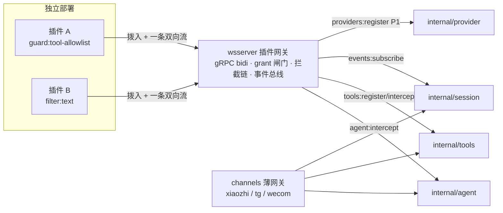
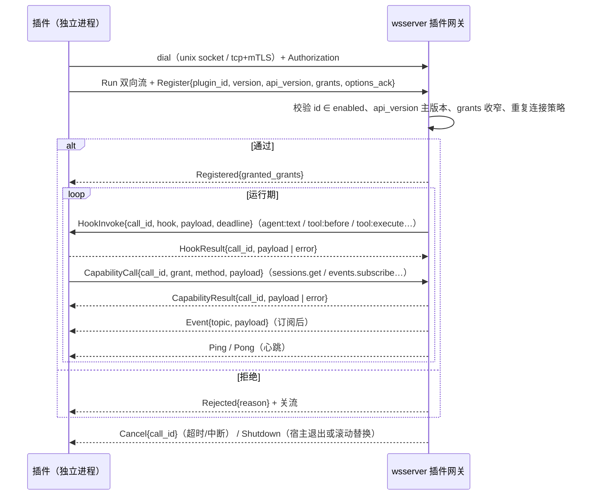

# wsserver 服务端插件能力设计（远程插件）

> 状态：设计稿 v2（插件独立部署 + 远程协议，方向已定；P0 未实现） | 日期：2026-10-11 | 范围：`cmd/wsserver` 插件网关（gRPC）+ `pkg/plugin` SDK + `api/plugin/v1` 协议；不改通道协议、不改 manager 控制面 | 关联：`internal/agent/`、`internal/tools/`、`internal/session/`、[refactor-dag-channels](./refactor-dag-channels.md)、[pi extensions](https://github.com/badlogic/pi-mono/blob/main/packages/coding-agent/docs/extensions.md)、[opencode plugins](https://opencode.ai/docs/plugins/)、[hashicorp/go-plugin](https://github.com/hashicorp/go-plugin)、[gRPC core concepts](https://grpc.io/docs/what-is-grpc/core-concepts/)
>
> 版本说明：v1 稿（编译期内嵌插件）作废。插件按「独立部署的远程服务」设计：wsserver 内建**插件网关**，插件拨入并保持一条 gRPC 双向流；契约、能力清单、钩子语义与 v1 一致，只是从「进程内调用」换成「网络调用」。

## 评审面（≤3 屏 / 约 120 行）

### 1. 结论与边界

插件是**独立部署的进程/服务**（自己的仓库、自己的发布节奏），通过 wsserver 的**插件网关**拨入：一条 gRPC 双向流同时承载 ①宿主→插件的钩子调用（`agent:text`、`tool:before`…）②插件→宿主的能力调用（`sessions.get`、`events.subscribe`…）③事件推送与心跳。宿主用 grant 闸门约束每个连接能做什么；扩展面 == 我们暴露的内部能力面——暴露多少，插件就能长成什么样。

gRPC 是合适的载体：双向流、原生 deadline/取消、全语言客户端、成熟运维面（health/reflection/keepalive）；先例是 Grafana 后端插件（gRPC over unix socket）与 hashicorp/go-plugin（gRPC + HTTP/2 多路复用）。代价是引入 proto 工具链与 grpc-go 依赖（`google.golang.org/protobuf` 已在依赖树中，边际成本可控）。P0 用「类型化信封 + JSON bytes 载荷」把协议跑通，避免 DTO 迭代期被 proto 锁死；后续可无损升级为全类型化消息。

| 决策 | 选择（被否候选） | 理由 | 代价 |
| --- | --- | --- | --- |
| D1 插件形态 | 独立部署 + 远程协议（否：编译期内嵌；否：宿主拉起 stdio 子进程） | 插件要独立发布/独立重启/独立扩缩；宿主与插件不共享故障域与编译期 | 需要协议、SDK、网关与连接生命周期管理 |
| D2 传输 | gRPC over HTTP/2（否：JSON-RPC over WebSocket；否：消息队列；否：宿主拨插件端点） | 双向流 + deadline/取消 + 全语言客户端 + keepalive/reflection；go-plugin/Grafana 先例 | proto 工具链 + grpc-go 依赖；插件作者需要 SDK 或代码生成 |
| D3 载荷编码 | v1：类型化信封 + JSON DTO bytes（否：一步到位全类型化 proto） | DTO 仍在演进，JSON 与 §4 契约同构、SDK 可读写；信封稳定后逐条升级为 proto 消息不破坏 wire | 弱 schema 约束；需要版本兼容纪律（只增字段） |
| D4 连接方向 | 插件拨入宿主网关、单连接多路复用（否：宿主拨插件端点 + 插件回调宿主；否：go-plugin 式双向 mux） | 插件无需监听端口；一处鉴权/限流/审计；断线重连语义简单；适合 sidecar/容器网络 | 自定义一条流的消息多路复用（封装在 SDK 内） |
| D5 扩展点模型 | 注册 + 拦截 + 观察 三类（否：只有事件总线；否：只有工具注册） | 覆盖"加能力/改行为/做集成"；语义分离才能逐点定失败策略 | 每个拦截点要声明语义、超时与失败策略 |
| D6 能力授权 | manifest 声明 + 配置授予 + 每次调用校验（否：暴露全部内部 API） | 插件是独立进程，天然不可信；越权拒绝 + 审计；grant 收窄只由配置裁定 | 新增 grant 概念与配置面 |
| D7 失败隔离 | 逐点 panic 恢复 + 超时 + fail-open/closed + 断线降级（否：插件报错即主链路失败） | 语音主链路延迟敏感，插件是增强不是依赖；插件崩溃/重启不能拖垮 wsserver | 失败语义逐点设计（§4.4）；断线期间的降级要可观测 |
| D8 与通道关系 | 网关与 channels 平行；通道是插件可注册的一种能力（否：插件=通道） | 注入点在 channels 之下的共享层（agent/tools/session），天然跨通道 | 绕过 Agent 的通道控制消息只享受会话级事件 |
| D9 热更新 | 重启插件进程 → 自动重连（否：宿主内热更） | 插件独立部署的直接红利：宿主零停机，滚动更新插件即可 | 更新瞬间钩子降级（按 fail policy），需要连接状态可观测 |

**非目标**：插件市场/远程分发；manager 控制台管理插件（P2 再议）；插件多实例/负载均衡（v2 单实例）；插件间直接通信（只走宿主事件）；`/ws` 协议与设备配置来源；计费口径可被插件影响；WAN 直连的 in-path 钩子（延迟不允许，见 §7）。

**现状**：`cmd/wsserver/main.go` 手工装配共享依赖（memory/tools/provider/session），通道在 `internal/channels/*` 各建 Agent/DAG；运行期没有任何外部扩展点。「输出过滤」「工具白名单」这类需求只能改通道代码。设备配置来自 manager，服务端配置只有 `wsserver.yaml`。

**为什么现在做**：DAG/通道分层已稳定（[refactor-dag-channels](./refactor-dag-channels.md) 已落地），共享层（`session`/`agent`/`tools`/`provider`）天然是通道无关的注入面；插件独立部署是既定方向，现在定协议与契约，后续所有扩展都不用再动通道。

**关键约束**：in-path 钩子（上下文/文本/工具）插件必须与 wsserver 同机或同 pod（unix socket / localhost），默认预算 ≤100ms/次，禁止在钩子里做网络 I/O；`api_version` 主版本必须匹配；`required: true` 的插件在 `connect_timeout` 内未连上则拒绝启动；非 required 插件未连接时其拦截按 fail policy 跳过并告警。

### 2. 骨架

| 模块 | 职责 | 不负责 | 依赖 | 落点 |
| --- | --- | --- | --- | --- |
| 协议 `api/plugin/v1` | proto：网关服务、信封、注册、钩子/能力帧；buf 生成 Go | 不含业务语义判定 | protobuf / grpc-go | `api/plugin/v1/plugin.proto` + 生成代码 |
| SDK `pkg/plugin` | 插件作者入口：DTO、`Manifest`、`Serve()`（拨入/重连/心跳）、`Host` 能力代理、钩子/工具注册的本地 API | 不做授权判定；不直接 import `internal/*` | protobuf、标准库 | `pkg/plugin/` |
| 宿主网关 `internal/plugin` | 监听（unix/tcp）、鉴权、注册与 grant 裁定、连接会话、钩子分发链、能力路由、事件总线、超时/熔断 | 不实现插件逻辑；不认识通道协议 | `api/plugin/v1` + 各内部包（仅适配层） | `internal/plugin/` |
| 适配层 | 内部类型 ↔ DTO：agent 上下文/文本、tools 执行、session 事件 | 不做语义变换 | `internal/agent`、`internal/tools`、`internal/session` | `internal/plugin/adapter_*.go` |
| 装配 | 启动顺序：网关 → plugins 接线 → channels；关闭反序 | 不做插件逻辑 | 网关 | `cmd/wsserver/main.go`、`cmd/wsserver/plugins.go` |
| 配置 | `plugins:` 段：网关监听/令牌、enabled 清单、grants、options、超时 | 不做控制面下发 | `wsserver.yaml` 现行加载 | `internal/channels/xiaozhi/config.go`（拆包见 §10 Q4） |
| 示例插件 | 独立可运行的插件二进制（toolguard / textfilter） | — | SDK | `examples/plugins/<name>/` |



关键约束：插件不知道通道的存在，通道也不知道插件的存在；二者只在共享层交会，因此「加插件 = 所有通道自动获得该能力」。

---

## 1. 调研

### 1.1 opencode

插件是**进程内 JS/TS 模块**，加载自 `.opencode/plugins/`、`~/.config/opencode/plugins/` 或配置里声明的 npm 包（Bun 启动时安装并缓存），加载顺序固定为「全局配置 → 项目配置 → 全局插件目录 → 项目插件目录」。插件函数收到 `{project, client, $, directory, worktree}`，返回钩子对象。

扩展点分两族：

| 家族 | 形态 | 例子 |
| --- | --- | --- |
| 事件（通知） | `event` 钩子 + 事件清单 | `session.created` / `session.idle` / `session.error`、`message.updated`、`tool.execute.after`、`permission.asked`、`file.edited`、`lsp.*`、`server.connected` |
| 拦截/变换 | 具名钩子，input/output 可读写，抛错即阻断 | `tool.execute.before`（改参数 / throw 拒绝）、`tool.execute.after`、`shell.env`、`experimental.session.compacting` |

插件还能注册工具（**同名覆盖内置**）。v2 的 Promise API 把扩展点收敛为两类原语：`ctx.<domain>.transform(editor)` 对**有状态域**（agent/model/provider/tool/…）做编辑器式贡献，配套 `reload()`/`dispose`；`ctx.<domain>.hook(...)` 对**运行路径**实时拦截（provider 派发前的 session context 改写、retry 决策等）。信任模型是本地全信任。

### 1.2 pi

扩展是**进程内 TS 模块**（jiti 直接跑；单文件或带 `index.ts` 的目录；npm 依赖放同目录 `package.json`），用户/项目目录或 `--extension` 加载。

API 是 `default export (pi: ExtensionAPI) => void` 的工厂 + 注册式：

| 类别 | API |
| --- | --- |
| 事件 | `pi.on(event, handler)`：`project_trust`、`session_start/shutdown`、`before_agent_start`、`agent_start/before_settle/settled/end`、`turn_end`、`message_end`、`context` / `context_with_system`、`tool_call`（改参/阻断）、`tool_result`（可组合改写）、`provider_stream_event`、`user_bash`、`model_select`、`cache_warming_decision` |
| 注册 | `registerTool`（`exposure`/`namespace`/`annotations`）、`registerCommand/Shortcut/Flag`、`registerProvider`、`registerMcpServer`、`registerVirtualModel`、`registerToolRenderer` |
| 控制 | `sendUserMessage/sendMessage`（注入对话）、`appendEntry`（不进上下文的持久状态）、`setActiveTools/getAllTools`、`ctx.executeTool`（嵌套调用）、`ctx.reload()` |

每个事件**声明自己的结果语义**：通知型忽略返回值；变换型返回替换值；可否决型返回 `{ block: true, reason }`。`tool_call` handler 失败会**阻断工具**（fail-safe）。生命周期纪律：factory 里不许起长驻资源，用 `session_start`/`session_shutdown`，清理必须幂等。工具注解（`readOnlyHint`/`destructiveHint`/`openWorldHint`）给权限类插件做决策依据。

### 1.3 远程插件先例（为什么 gRPC 是常见答案）

| 先例 | 协议与形态 | 可借鉴点 |
| --- | --- | --- |
| [hashicorp/go-plugin](https://github.com/hashicorp/go-plugin)（Terraform/Vault/Nomad） | gRPC，宿主拉子进程，**单连接 + HTTP/2 多路复用**，握手 + mTLS 选项，官配 broker 做反向调用 | 单连接多路复用是成熟形态；gRPC 选择被大规模验证；「只适合本地可靠网络」的定位与我们 in-path 同机约束一致 |
| Grafana 后端插件 | gRPC over **unix domain socket**，插件 SDK 化 | unix socket 默认、SDK 封装协议是插件生态的关键 |
| Quorum 插件 | go-plugin + gRPC，**mTLS**，LocalInit 初始化调用 | 双向认证 + 初始化握手的组合 |
| MCP（本仓库已在用） | JSON-RPC 2.0（stdio / streamable HTTP），工具提供方协议 | 对比项：MCP 面向"工具提供方"，没有宿主→插件拦截与反向能力调用模型；两者互补（工具仍可来自 MCP），插件协议另起一层 |
| [ConnectRPC](https://connectrpc.com) | 同一份 proto 同时提供 gRPC/Connect/gRPC-Web 协议，net/http 集成、curl 可调 | 备选实现：若后续想让网关支持 HTTP JSON 调试面，可换 Connect-Go 而不动 proto 与客户端 |

### 1.4 给 Orion-X 的可迁移结论

| # | 结论 | 来源 | 我们的修正 |
| --- | --- | --- | --- |
| C1 | 扩展点分「事件（观察）/ 拦截（变换/否决）/ 注册（加能力）」三族 | opencode + pi | 事件与拦截同表不同语义，逐点声明失败策略（pi 的 declared result type） |
| C2 | 每个处理函数拿到随调用下发的上下文（session/turn/abort/deadline） | opencode + pi | DTO 化（`ContextEvent`/`TextEvent`），不把 `*session.Session` 交出去 |
| C3 | 插件可注册工具且同名可覆盖内置 | opencode | 采纳；覆盖要告警；优先级与顺序写死（§4.4） |
| C4 | 注册式 API + 撤销句柄 / 域 reload | opencode v2 | 采纳：注册返回 `Unsubscribe`；reload 由"重启插件进程自动重连"替代（D9） |
| C5 | 生命周期纪律：初始化不起长驻资源、清理幂等、故障隔离 | pi | 强制：`Setup` 只注册；后台工作从 `Start`（连接就绪）后起；`Teardown` 幂等 |
| C6 | 工具注解驱动权限决策 | pi | 采纳进契约（`ToolSpec.Annotations`），P0 不阻塞 |
| C7 | 本地全信任 | opencode + pi | **不采纳**：插件独立进程按不可信对待，manifest + grant + 每次调用校验 |
| C8 | 运行时下载依赖 | opencode | **不采纳**：插件是部署产物（容器/二进制），数据面不做包管理 |
| C9 | 单连接 + 多路复用、unix socket 默认、mTLS 可选 | go-plugin / Grafana | 采纳；多路复用封装在 SDK 里（D4） |
| C10 | 协议先行（proto schema + 代码生成 + 版本纪律） | go-plugin / Connect | 采纳；v1 信封类型化、载荷 JSON（D3），buf lint/breaking 进 CI |

---

## 2. 概念与模型

- **插件（Plugin）**：独立部署的进程/服务，用 SDK（或任意语言按协议实现）拨入宿主，声明身份与申请能力，注册钩子/工具/订阅。
- **插件网关（Gateway）**：wsserver 内的宿主组件，提供 gRPC 服务；一个插件一条 `Run` 双向流；负责鉴权、grant 裁定、钩子分发、能力路由、超时与审计。
- **能力（Capability）**：宿主暴露的窄接口与 wire 方法（`sessions.get`、`tools.intercept`…）。grant 名单是唯一开关，每次调用校验。
- **拦截（Intercept）**：参与主链路的有序调用链，可变换/可否决；在网关上表现为"宿主→插件的一次 `HookInvoke`"。
- **事件（Event）**：异步、有界、不阻塞主链路的通知；订阅后由宿主推送。
- **注册（Register）**：插件在连接期或运行期向宿主注册新产物（工具、Provider、HTTP 路由、通道）。

三类扩展点与现行代码的对应：

| 类别 | 语义 | 落点（P0） |
| --- | --- | --- |
| 注册 | 加能力，宿主管理生命周期 | `tools.Registry.Add`（工具 + `tool:execute` 回调）、`provider` 注册表（P1）、`channels.Manager.Register`（P1） |
| 拦截 | 改参数/改结果/否决 | Agent 上下文与文本（`internal/agent/context_builder.go` / `step.go`）、工具执行（`internal/tools/registry.go#Execute`） |
| 观察 | 只读通知 | `session:created/closed`（`internal/session/manager.go`）、`turn:started/finished`（`internal/agent/loop.go`）、`tool:called`、`memory:recorded` |

**连接模型（D4）**：插件是 gRPC 客户端，网关是 gRPC 服务端。理由：插件不监听端口（防火墙/权限简单）、一处鉴权限流、断线重连天然（重启插件即重连，D9）、能力调用与钩子共享一条流不需要第二个回调地址。被否方案：宿主拨插件端点（每个插件要配 endpoint，还要第二条回调连接）；go-plugin 式同连接双向 mux（复杂度不值得）。

**与 channels 的关系**：`channels.Channel` 是"一种被注册的对外连接方式"；插件网关与它是同级组件，不是父级。通道通过 `channels.Dependencies` 拿共享层；插件往共享层注入钩子。两边互不引用。

---

## 3. 架构与落点

### 3.1 包结构

```text
api/plugin/v1/               # 协议（buf 生成，公共可 import）
├── plugin.proto             # PluginGateway 服务 + 信封/注册/钩子/能力消息
├── plugin.pb.go             # 生成物（提交进仓库）
└── plugin_grpc.pb.go

pkg/plugin/                  # 插件 SDK（插件作者依赖；零 internal 依赖）
├── manifest.go              # Manifest / Capability / ID 规则
├── dto.go                   # ContextEvent / TextEvent / ToolCall / ToolResult / SessionEvent…
├── host.go                  # Host 与各能力接口（本地 API 形态）
├── serve.go                 # Serve()：拨入、注册、重连退避、心跳、帧循环
├── client.go                # 能力代理：Host 接口 → capability.call 帧
└── errors.go                # ErrCapabilityDenied / ErrUnavailable 等

internal/plugin/             # 宿主网关
├── gateway.go               # gRPC server 装配：监听、TLS/令牌、连接注册表
├── session.go               # 单插件连接会话：注册握手、帧读写、call 关联、心跳
├── grants.go                # manifest ∩ 配置的 grant 裁定与每次调用校验
├── bus.go                   # 事件总线（订阅、有界队列、丢弃计数、推送编码）
├── chain.go                 # 拦截链（顺序、超时、取消、fail policy、熔断）
├── adapter_agent.go         # agent.Hooks ↔ DTO（BeforeContext / OnText）
├── adapter_tools.go         # tools middleware + 远程工具（tool:execute）
└── adapter_session.go       # 会话事件源

examples/plugins/            # 示例插件（独立 main，可单独构建/部署）
├── toolguard/
└── textfilter/
```

规则：`pkg/plugin` 不 import `internal/*`；协议层（`api/plugin/v1`）不依赖 SDK；`internal/plugin` 适配层单向依赖内部包；内部包（agent/tools/session）不知道自己被远程拦截（只认识自己包里声明的小接口，如 `agent.Hooks`，见 §9 P0 第 4 条）。

### 3.2 装配顺序（`cmd/wsserver/main.go`）

```text
load config → logging → memorySvc → toolMgr
→ deps(sessions/tasks/providers/billing/keyVerifier)
→ 构建插件网关（gateway listen + 适配器 + 配置的 enabled 清单）
→ gateway.Start()                    # 先能接受拨入
→ 等待 required 插件连上（connect_timeout）
→ chMgr := channels.NewManager(deps)；注册内置通道 + 插件注册的通道
→ gateway.Activate(ctx)              # 插件后台任务/工具注册开始生效
→ chMgr.Start(ctx) → health
...
shutdown：health.Stop → chMgr.Stop → gateway.Stop（对插件发 Shutdown、等待 teardown、幂等）
```

关键约束：`Setup`（即插件连接后的注册阶段）只做注册；插件要在 `Start`（宿主确认注册完成）后才能起来后台任务（C5）。非 required 插件允许迟到连接；迟到前其拦截按 fail policy 跳过。

### 3.3 连接与生命周期



**重复连接策略**：同一 `plugin_id` 只允许一条活跃连接；新连接替换旧连接（旧流收到 `Shutdown` 后关闭），以支持滚动更新。v2 不做多实例负载均衡（留白，§10 Q6）。

### 3.4 部署形态

| 形态 | 网络 | 适用 |
| --- | --- | --- |
| 同机进程 | `unix:///run/orion/plugins.sock`（默认，文件权限 0600） | 开发、单机部署、in-path 钩子 |
| sidecar（同 pod / 同 compose network） | `unix://`（共享 volume）或 `tcp://127.0.0.1` | 生产推荐；in-path 延迟可控 |
| 远程服务 | `tcp://` + mTLS/令牌 | 仅 out-of-path 钩子（观察类、注册类）；禁止承载 in-path 钩子 |

---

## 4. 能力 API（暴露面）

> 这一节就是"插件能长成什么样"的答案：只有列在这里的接口与 wire 方法存在。

### 4.1 能力清单

| grant | SDK 接口（插件侧） | wire 方法（插件 → 宿主） | 底层内部能力 | 风险 | 阶段 |
| --- | --- | --- | --- | --- | --- |
| `events:subscribe` | `Events().Subscribe(topic, fn)` | `events.subscribe` / `events.unsubscribe`（事件走 `HostFrame.event` 推送） | 会话/回合/工具/记忆事件 | 低 | P0 |
| `events:publish` | `Events().Publish(topic, payload)` | `events.publish` | 总线 | 低 | P0 |
| `sessions:read` | `Sessions().List()/Get(id)` → `SessionInfo` + 最近 N 条消息 | `sessions.list` / `sessions.get` | `session.Manager` | 中（对话内容） | P0 |
| `sessions:inject` | `Sessions().Inject(id, Message)` | `sessions.inject` | 通道输出/DAG（P1 接） | 高 | P1 |
| `agent:intercept` | `Agent().BeforeContext(fn)` / `Agent().OnText(fn)` | 注册后由 `HookInvoke` 回调 | `agent.buildContextMessages` / `step.go` | 中（可改写模型输入/用户输出） | P0 |
| `tools:register` | `Tools().Register(ToolSpec)` / `Override(ToolSpec)` | `tools.register` / `tools.override`；执行经 `HookInvoke{hook:"tool:execute"}` | `tools.Registry.Add` | 中（新执行面） | P0 |
| `tools:intercept` | `Tools().Intercept(fn)` | `tools.intercept`（注册）；调用经 `HookInvoke{hook:"tool:before/after"}` | `tools.Registry.Execute` | 高（可否决一切工具） | P0 |
| `providers:register` | `Providers().RegisterLLM/ASR/TTS(...)` | `providers.register`（执行流 P1 另定） | `provider` 注册表 | 中 | P1 |
| `memory:read` / `memory:write` | `Memory().Search(...)` / `Record(...)` | `memory.search` / `memory.record` | `memory.Service` | 中 | P1 |
| `tasks:read` / `tasks:write` | `Tasks().Search/Create/Mount` | `tasks.search` / `tasks.create` / `tasks.mount` | `task.Registry` | 中 | P1 |
| `channels:register` | `Channels().Register(ChannelSpec)` | `channels.register` | `channels.Manager.Register` | 高 | P1 |
| `http:serve` | `HTTP().Handle(pattern, handler)` | `http.handle`（宿主专用监听，默认关闭） | net/http | 高（新入口） | P1 |
| `storage:kv` | `Store().Get/Set/Delete`（按插件 ID 命名空间隔离） | `store.get/set/delete` | 新增（内存/文件） | 低 | P1 |
| `config:read` | `Config().Options()/Get(key)` | 注册帧携带 options，无需调用 | 配置加载 | 低 | P0 |

**不暴露**（有意为之）：计费写口径（用量/价格不可被插件改）、设备明文凭证、manager 内部端点、DB/store、`internal/*` 具体结构体与控制权（插件只拿 DTO 快照）。P0 只开放 `events:*`、`sessions:read`、`agent:intercept`、`tools:register/intercept`、`config:read`。

### 4.2 SDK 契约草图（`pkg/plugin`）

```go
// Manifest 是插件的静态身份与要求；ID 采用 "namespace:name" 形态（如 "guard:tool-allowlist"）。
type Manifest struct {
    ID         string
    Version    string
    APIVersion string       // 宿主插件 API 版本，如 "1"；主版本必须一致
    Grants     []Capability // 申请的能力；最终授予 = manifest ∩ 配置
}

// Serve 拨入网关并保持连接；重连退避、心跳、帧循环都在这里。
// cfg.Handler 与 v1 设计一致：Setup 只注册，返回的 Teardown 幂等。
func Serve(ctx context.Context, cfg ServeConfig) // ServeConfig{Addr, Token, TLS, Handler Handler}

type Handler interface {
    Manifest() Manifest
    Setup(ctx context.Context, host Host) (Teardown, error)
}

type Teardown func(ctx context.Context) error

// Host 是能力入口；未授予的能力返回 ErrCapabilityDenied 的代理，而不是 nil。
// 所有方法都通过一条连接上的 capability.call 帧实现（client.go）。
type Host interface {
    Log() Logger
    Events() EventBus          // events:subscribe / events:publish
    Sessions() SessionStore    // sessions:read / sessions:inject
    Agent() AgentInterceptor   // agent:intercept
    Tools() ToolRegistry       // tools:register / tools:intercept
    Config() ConfigSource      // config:read
    // P1：Providers() / Memory() / Tasks() / Channels() / HTTP() / Store()
}

type AgentInterceptor interface {
    // BeforeContext 在每次 LLM 请求构建完消息后、发送前调用；可增删改消息或收窄工具集。
    BeforeContext(fn func(ctx context.Context, ev *ContextEvent) error) Unsubscribe
    // OnText 对 Agent 的流式文本增量逐块调用；返回空串表示吞掉该块。
    OnText(fn func(ctx context.Context, ev *TextEvent) (string, error)) Unsubscribe
}

type ToolRegistry interface {
    Register(spec ToolSpec) error             // 新增工具；执行经 tool:execute 回调
    Override(spec ToolSpec) error             // 同名覆盖内置（告警）
    Intercept(fn ToolMiddleware) Unsubscribe  // 洋葱中间件；可改参、可短路、可否决
}

// ToolMiddleware 是洋葱链：先注册者在外层；next 对远程插件来说是 SDK 提供的回调。
type ToolMiddleware func(ctx context.Context, call *ToolCall, next ToolNext) (ToolResult, error)

type Decision struct { // 拦截点的裁决值
    Allow  bool
    Reason string // Allow=false 时回给 LLM 的可恢复错误文本
}
```

适配层职责：`ContextEvent.Messages` ↔ `[]llm.Message`、`TextEvent.Chunk` ↔ `TextChunkEvent`、`ToolCall/ToolResult` ↔ `tools.Spec`/`tools.Result`/`session.Message`、`SessionInfo` ↔ `session.Session`。映射只做拷贝与投影，不做语义判定。

### 4.3 钩子与事件清单（P0）

方向说明：`Host→Plugin` 是钩子调用；`Plugin→Host` 是能力调用；事件是 `Host→Plugin` 推送。

| 名称 | 方向 | 类型 | 载荷（DTO） | 语义 | 默认失败策略 | 挂点 |
| --- | --- | --- | --- | --- | --- | --- |
| `agent:context:before` | H→P | 拦截 | `ContextEvent{Session, Messages, Tools}` | 变换（可改/可删/可加） | fail-open（用原始上下文） | `agent.buildContextMessages` 之后、`runStep` 之前 |
| `agent:text` | H→P | 拦截 | `TextEvent{Session, Turn, Chunk}` | 变换（可改写/吞掉） | fail-open（原样输出） | `step.go` 发出 `TextChunkEvent` 前 |
| `tool:before` | H→P | 拦截 | `ToolCall{Session, Name, Arguments}` | 变换+否决（中间件可短路） | **fail-closed**（拒绝该次调用，返回可恢复错误） | `tools.Registry.Execute` |
| `tool:after` | H→P | 拦截 | `ToolResult{Call, Output, Error}` | 变换（脱敏/截断） | fail-open（用原始结果） | 同上（洋葱回程） |
| `tool:execute` | H→P | 执行 | `ToolCall{Session, Name, Arguments}` | 仅 `tools:register` 注册的工具；SDK 分发到本地函数 | fail-closed（返回 tool 错误） | `tools.Registry.Execute` → 远程工具 |
| `session:created` | H→P | 事件 | `SessionEvent{SessionID, Channel, DeviceID, UserID}` | 通知 | 丢弃+计数 | `session.Manager.Add` |
| `session:closed` | H→P | 事件 | 同上 | 通知 | 丢弃+计数 | `session.Manager.CloseSession` |
| `turn:started` | H→P | 事件 | `TurnEvent{SessionID}` | 通知 | 丢弃+计数 | `agent.Run` 入口 |
| `turn:finished` | H→P | 事件 | `TurnEvent{SessionID, Err, Usage}` | 通知 | 丢弃+计数 | `FinishedEvent` 消费点 |
| `tool:called` | H→P | 事件 | `ToolResult` 快照 | 通知 | 丢弃+计数 | `runOneToolCall` 完成后 |
| `memory:recorded` | H→P | 事件 | `MemoryEvent{SessionID, TurnID}` | 通知 | 丢弃+计数 | `agent.recordTurn` |

P1 预留：`input:before`（入站消息统一拦截，会话层收口）、`llm:request/response`、`provider:*`、`session:injected`。命名遵循项目标识约定：自研标识值统一 `:` 分段。

### 4.4 顺序、并发与超时

- **顺序**：拦截链按插件连接顺序（= 配置 `enabled` 列表顺序，插件迟到则排到末尾），同插件按注册顺序；`tool:before` 洋葱先注册者在外层，`tool:after` 逆序回程。事件按订阅顺序异步推送。
- **并发**：一条 `Run` 流内多路复用，按 `call_id` 关联；宿主对同一插件的在途调用设上限（默认 64），`agent:text` 天然串行（流式路径）；插件侧 SDK 负责并发安全分发，插件 handler 须自证并发安全。
- **超时与取消**：每个 `HookInvoke` 带 `deadline_unix_ms`；到期宿主发 `Cancel{call_id}` 并按该点 fail policy 处理；`runtime` 预算默认：in-path 100ms（`plugins.hook_timeout` 可调），事件与能力调用 1s。
- **流量与背压**：gRPC flow control + 宿主侧每插件在途上限；事件总线有界（满则丢弃并计数）；单帧大小上限（P0 1MB，超出截断并告警）。
- **失败熔断（P1）**：同插件连续失败 N 次（默认 5）自动停用其拦截注册并告警；重连后清零。
- **断线降级（D7）**：流断开 → 该插件所有拦截按各自 fail policy 处理、事件停止推送；`registered` 状态从网关移除并计数；重连成功后自动恢复（重新注册 = 插件重新 Setup）。

---

## 5. 传输与协议（gRPC 评估）

### 5.1 选型对比

| 维度 | gRPC（推荐） | ConnectRPC | JSON-RPC over WebSocket | stdio JSON-RPC | 消息队列 |
| --- | --- | --- | --- | --- | --- |
| 双向流 | 原生 bidi | 原生（HTTP/2） | 原生（WS 全双工） | 伪全双工 | 否（仅异步） |
| deadline/取消 | 原生 | 原生 | 自建超时帧 | 自建 | 无 |
| 独立远程部署 | 是 | 是 | 是 | 否（宿主拉子进程） | 是 |
| 多语言客户端 | 全语言 | 全语言（含浏览器） | 全语言 | 全语言 | 全语言 |
| 调试面 | grpcurl/reflection | curl/HTTP JSON | wscat | 管道日志 | 控制台 |
| 运维面 | health/keepalive/reflection | HTTP 中间件 | 自建 | 自建 | 队列自带 |
| 依赖成本 | grpc-go + protobuf + buf | connect-go + protobuf + buf | 零依赖 | 零依赖 | broker 依赖 |
| 适配度 | **高** | 高（备选实现） | 中（基础设施全靠自建） | 低（与"独立"矛盾） | 低（无 in-path 语义） |

**结论（D2）**：gRPC。理由：①bidi 一条流同时承载双向调用（D4 的前提）；②deadline/取消/keepalive 是原生能力，不用自建；③全语言标准客户端 = 插件生态门槛最低；④go-plugin/Grafana/Quorum 先例验证了"插件系统用 gRPC"的形态；⑤本仓库已有 `google.golang.org/protobuf` 间接依赖，新增主要是 `google.golang.org/grpc` + buf 工具链。备选 ConnectRPC：如果后续要让网关同时提供 HTTP JSON 调试面，换 Connect-Go 即可，proto 与 gRPC 客户端不受影响（§10 Q3 的后路）。

**明确否认的形态**：宿主拉起 stdio 子进程（MCP 形态）——与"插件独立部署"矛盾；消息队列——没有请求/响应与取消语义，无法做 in-path 拦截。

### 5.2 proto 草案（`api/plugin/v1/plugin.proto`）

```proto
syntax = "proto3";
package orion.plugin.v1;
option go_package = "github.com/liuscraft/orion-x/api/plugin/v1;pluginv1";

// PluginGateway 由 wsserver 提供；插件作为 gRPC 客户端拨入并建立一条会话流。
service PluginGateway {
  rpc Run(stream PluginFrame) returns (stream HostFrame);
}

message PluginFrame {
  oneof body {
    Register register = 1;            // 会话首帧，必须
    HookResult hook_result = 2;       // 回应 HostFrame.hook
    CapabilityCall capability = 3;    // 插件 → 宿主能力调用
    Pong pong = 4;                    // 心跳回应
  }
}

message HostFrame {
  oneof body {
    Registered registered = 1;        // 注册通过（授予的 grants）
    Rejected rejected = 2;            // 注册拒绝（reason 后关流）
    HookInvoke hook = 3;              // 宿主 → 插件钩子调用
    HookCancel cancel = 4;            // 超时/中断取消
    CapabilityResult capability_result = 5;
    Event event = 6;                  // 已订阅事件推送
    Ping ping = 7;                    // 心跳探测
    Shutdown shutdown = 8;            // 宿主退出/连接被替换
  }
}

message Register {
  string plugin_id = 1;               // "guard:tool-allowlist"
  string version = 2;                 // 插件版本
  string api_version = 3;             // 主版本必须与宿主一致
  repeated string grants = 4;         // 申请能力（配置裁定，只会收窄）
  bytes options = 5;                  // 宿主注入的 options（JSON）
}

message HookInvoke {
  string call_id = 1;
  string hook = 2;                    // "agent:text" / "tool:before" / "tool:execute" ...
  bytes payload = 3;                  // DTO JSON（D3：v1 载荷）
  int64 deadline_unix_ms = 4;
}

message HookResult {
  string call_id = 1;
  bytes payload = 2;
  PluginError error = 3;
}

message CapabilityCall {
  string call_id = 1;
  string grant = 2;                   // "sessions:read" ...
  string method = 3;                  // "sessions.get" / "events.subscribe" ...
  bytes payload = 4;
}

message CapabilityResult {
  string call_id = 1;
  bytes payload = 2;
  PluginError error = 3;
}

message Event {
  string topic = 1;                   // "session:created" ...
  bytes payload = 2;
}

message PluginError {
  string code = 1;                    // "capability_denied" / "timeout" / "internal" ...
  string message = 2;
}
```

### 5.3 载荷编码（D3）与版本

- v1 所有业务载荷（`payload`）是 §4 契约 DTO 的 JSON bytes；proto 只固定**信封**。好处：DTO 与 SDK 同源、迭代成本低、宿主与插件可用同一套 `pkg/plugin` 类型；代价：弱 schema 校验，靠"只增字段 + 未知字段忽略"纪律。
- 升级路径：信封稳定后，把热点载荷（`agent:text`、`tool:before`）逐条升级为 proto 消息（`payload` 改为 `oneof`），旧客户端继续走 bytes 分支，不破坏 wire。
- `api_version` 取主版本（"1"）；主版本不一致 → `Rejected{reason:"api_version_mismatch"}`；次版本演进只增字段。

### 5.4 连接、认证与运维面

- 监听：默认 `unix:///run/orion/plugins.sock`（0600）；可选 `tcp://127.0.0.1:9101`；远程部署必须 mTLS（grpc credentials）+ 令牌双保险。
- 认证：拨入元数据 `authorization: Bearer <token>`；支持全局令牌或 `plugin_tokens: {id: token}` 按插件发（推荐，便于单插件吊销）。认证先于注册；失败即在元数据层拒绝并审计。
- 心跳：SDK 每 10s 发 `Ping/Pong`（或 gRPC keepalive 由 SDK 配置）；宿主 30s 无帧视为掉线，主动断流。
- 观测：网关暴露 `plugins` 状态（id、version、注册的钩子、grants、连接时长、失败计数），先打日志，P1 挂 `/plugins` HTTP 端点与指标。
- 工具链：`buf lint` + `buf breaking` 进 CI；`make proto` 生成 `api/plugin/v1`；`grpcurl` + reflection（P1）调试 `Run` 流。

---

## 6. 配置与加载

```yaml
plugins:
  gateway:
    listen: "unix:///run/orion/plugins.sock"   # 默认；tcp://127.0.0.1:9101 可选
    token: "${ORION_PLUGIN_TOKEN}"             # 全局令牌；或用 plugin_tokens 按插件发
    # plugin_tokens: { "guard:tool-allowlist": "${TOOLGUARD_TOKEN}" }
    tls: { enabled: false }                    # tcp 远程时必须启用（mTLS）
  connect_timeout: 5s      # required 插件的连接等待窗口（启动期）
  hook_timeout: 100ms      # in-path 拦截默认预算
  enabled:
    - id: "guard:tool-allowlist"
      required: true       # 启动期必须连上，否则进程拒绝启动
      grants: ["tools:intercept"]          # 缺省 = manifest 申请值；配置只能收窄
      options: { allow: ["getTime", "mcp__*"] }
    - id: "filter:text"
      grants: ["agent:intercept"]
  disabled:
    - "demo:echo"
```

- **配置是唯一权威**：插件不在 `enabled` 里 → 注册被拒（`plugin_not_enabled`）；grants 越权 → 收窄到配置值；`api_version` 不匹配 → 拒绝。保持 fail-closed。
- **加载顺序** = `enabled` 列表顺序 = 拦截顺序（迟到插件排到末尾）。
- **options** 随 `Register` 下发（JSON）；密钥建议走环境变量插值，不落 configmap。
- **热更新（D9）**：滚动重启插件进程 → 自动重连替换旧连接；宿主零停机。
- **禁用插件**：从 `enabled` 移除并重启宿主（v2 不做运行期踢出；P1 可加 `plugins.reload` 或 SIGHUP 重读配置后断开被移除连接）。

---

## 7. 安全与可靠性

| 关注点 | 措施 |
| --- | --- |
| 信任模型 | 插件=独立进程，默认不可信：manifest 声明 + 配置授予 + 每次 capability.call 校验 grant |
| 传输安全 | unix socket 默认（文件权限）；tcp 必须 mTLS + 令牌；元数据鉴权先于注册 |
| 最小授权 | 未授予调用返回 `capability_denied` 并审计；配置只能收窄 manifest |
| 越权数据 | 会话读取给 DTO；不暴露设备凭证/计费写/DB；`config:read` 只给插件自己的 options |
| 故障隔离 | 逐点 panic 恢复（宿主侧）、超时+取消、熔断（P1）、事件有界丢弃；插件崩溃不影响宿主 |
| 资源限额 | 每插件在途调用上限、帧大小上限、事件发布频率上限（P1）、远程插件建议独立容器限额 |
| 延迟预算 | in-path 钩子仅允许同机/sidecar（D2/§3.4）；默认 100ms；基准测试记录 unix socket 往返 P50/P99 |
| 审计 | 连接/注册/拒绝/越权/否决决策打 `plugin[<id>]` 前缀日志；P2 汇聚 manager 控制台 |
| 计费边界 | 插件不能触碰用量与定价；`memory:write` 等只影响自身域 |

---

## 8. 示例插件（P0 验收样例）

### 8.1 `guard:tool-allowlist`（独立二进制）

```go
// examples/plugins/toolguard/main.go
func main() {
    plugin.Serve(context.Background(), plugin.ServeConfig{
        Addr:  os.Getenv("ORION_PLUGIN_GATEWAY"), // unix:///run/orion/plugins.sock
        Token: os.Getenv("ORION_PLUGIN_TOKEN"),
        Handler: &guard{},
    })
}

type guard struct{}

func (g *guard) Manifest() plugin.Manifest {
    return plugin.Manifest{ID: "guard:tool-allowlist", APIVersion: "1", Grants: []plugin.Capability{"tools:intercept"}}
}

func (g *guard) Setup(ctx context.Context, host plugin.Host) (plugin.Teardown, error) {
    return host.Tools().Intercept(func(ctx context.Context, call *plugin.ToolCall, next plugin.ToolNext) (plugin.ToolResult, error) {
        if !g.allow(call.Name) {
            return plugin.ToolResult{Output: "error: tool blocked by policy"}, nil // 可恢复错误，LLM 能看到原因
        }
        return next(ctx, call)
    }), nil
}
```

### 8.2 `filter:text`（文本过滤）

```go
func (p *Plugin) Setup(ctx context.Context, host plugin.Host) (plugin.Teardown, error) {
    return host.Agent().OnText(func(ctx context.Context, ev *plugin.TextEvent) (string, error) {
        return p.replace(ev.Chunk), nil // 对文本链路生效；TTS 拿到的是替换后的文本
    }), nil
}
```

### 8.3 远程工具注册（执行路径示例）

```go
host.Tools().Register(plugin.ToolSpec{
    Name:        "translate",
    Description: "翻译文本",
    Parameters:  []byte(`{"type":"object","properties":{"text":{"type":"string"}}}`),
    Execute: func(ctx context.Context, args json.RawMessage) (plugin.ToolResult, error) {
        // 宿主发起 tool:execute 钩子；SDK 分发到这里。
        return plugin.ToolResult{Output: translate(args)}, nil
    },
})
```

### 8.4 观察型：会话审计

```go
host.Events().Subscribe("session:created", func(ctx context.Context, ev plugin.Event) {
    audited := ev.(*plugin.SessionEvent)
    host.Log().Info("session started", "session", audited.SessionID, "channel", audited.Channel)
})
```

---

## 9. 落地计划

### P0（本设计第一步）

1. 协议：`api/plugin/v1/plugin.proto` + `buf.yaml`/`buf.gen.yaml` + `make proto`；`buf lint` 进 CI。
2. SDK `pkg/plugin`：DTO、`Manifest`、`Serve`（拨入/重连退避/心跳/帧循环）、`Host` 能力代理、`Unsubscribe`/`Teardown` 语义。
3. 宿主 `internal/plugin`：网关监听与鉴权、注册握手与 grant 裁定、连接会话（call 关联/在途上限/心跳）、拦截链（顺序/超时/取消/recover/fail policy）、事件总线、能力路由。
4. 内部接线：`internal/agent` 增加可选 `Hooks` 小接口（`BeforeContext`/`OnText`，nil = 现状零开销）；`internal/tools` 增加 `Registry.Use(mw)` 洋葱中间件与远程工具执行；`internal/session` 增加可选事件 sink（`session:created/closed`）。
5. 配置：`plugins:` 段（§6）+ 启动期 required 等待。
6. 示例插件两个（`examples/plugins/toolguard`、`examples/plugins/textfilter`）+ 宿主集成测试用内存 fake 插件（不走网络的 conformance）。
7. 验收：`go test ./...`、`golangci-lint run ./...`、`buf lint`。

### P1

- 能力扩容：`sessions:inject`、`providers:register`、`memory:*`、`tasks:*`、`channels:register`、`http:serve`、`storage:kv`。
- 运维面：`/plugins` 状态端点、指标、grpc reflection、mTLS、per-plugin 令牌轮换、失败熔断、限流。
- 配置热更新：SIGHUP/`plugins.reload`（断开被移除插件、接收新 grant 配置）。

### P2

- manager 控制面打通：插件清单/grants 下发、审计与状态汇聚、版本管理。
- 插件包规范与分发；载荷全类型化升级（D3 路径）；ConnectRPC 调试面评估。

### 验证

1. 闸门：未授权 `capability.call` → `capability_denied` + 审计；配置外插件注册被拒。
2. 启动：`required` 插件在 `connect_timeout` 内未连上 → 启动失败；非 required 迟到连接前后钩子行为符合 fail policy。
3. 版本：`api_version` 主版本不一致 → `Rejected`；JSON 载荷未知字段被忽略（兼容性测试）。
4. 失败隔离：插件 panic/超时/断流 → 主链路不受影响；重启插件自动重连恢复（滚动更新 = 替换旧连接）。
5. 语义：`tool:before` 拒绝 → LLM 收到可恢复的 tool 错误，不终止 Run（对齐 `runOneToolCall`）；`OnText` 替换对 TTS 与各通道同时生效。
6. 延迟：unix socket 上 in-path 钩子往返 P50/P99 基准记录在案（对照 100ms 预算）。
7. 并发：多插件多钩子并发下无死锁/饥饿；`-race` 通过。
8. `go test ./...`、`golangci-lint run ./...`、`buf lint` 全绿。

---

## 10. 开放问题

| # | 问题 | 倾向 |
| --- | --- | --- |
| Q1 | `agent:text` 是否要区分"仅展示文本"与"送给 TTS 的文本"？ | P0 不区分（过滤对两端生效）；出现真实需求再拆 `agent:text:display` / `agent:text:speech` |
| Q2 | 入站消息统一拦截（`input:before`）放哪：会话层还是通道层？ | 需要通道把"用户消息写入会话"收口到 `session.Manager`，P1 做 |
| Q3 | JSON 载荷升级为类型化 proto 的时机与粒度？ | 信封稳定 + 热点钩子的 DTO 冻结后，逐条升级（`oneof` 兼容）；先给 `agent:text`、`tool:before` 试 |
| Q4 | 进程级配置何时从 `internal/channels/xiaozhi/config.go` 拆出独立包？ | 随 P0 一起拆（`plugins` 段是第一批"非通道"配置），或先挂着——实现时二选一 |
| Q5 | 插件是否需要 per-device/per-voicebot 粒度（而非进程级）？ | DTO 已带 `DeviceID`；P0 不做按设备启停；等控制面需求 |
| Q6 | 同一插件多实例/负载均衡是否要做？ | v2 单实例（D9 滚动替换）；多实例等出现吞吐需求再设计 |
| Q7 | 网关是否允许直接暴露在 WAN？ | 默认仅本机 unix/localhost；远程必须 mTLS，且只承载 out-of-path 钩子 |
